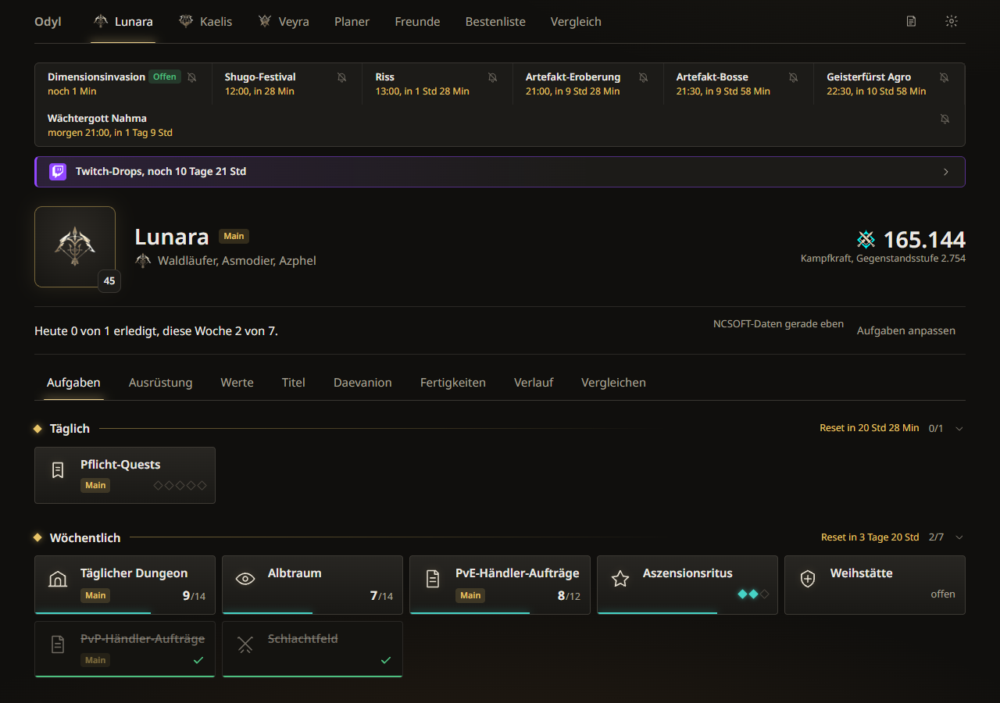
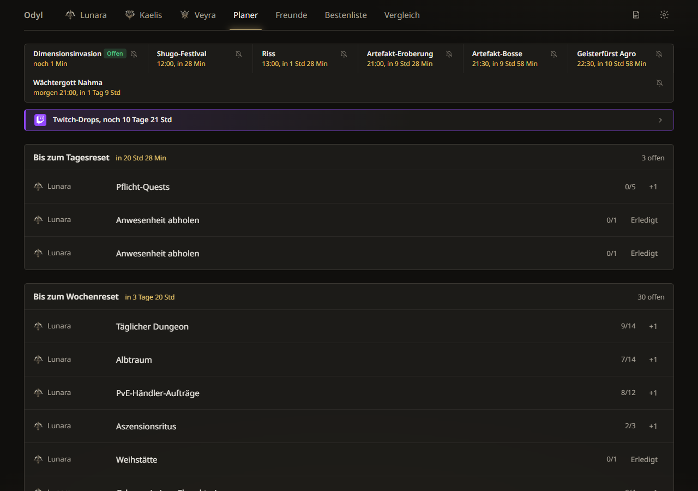
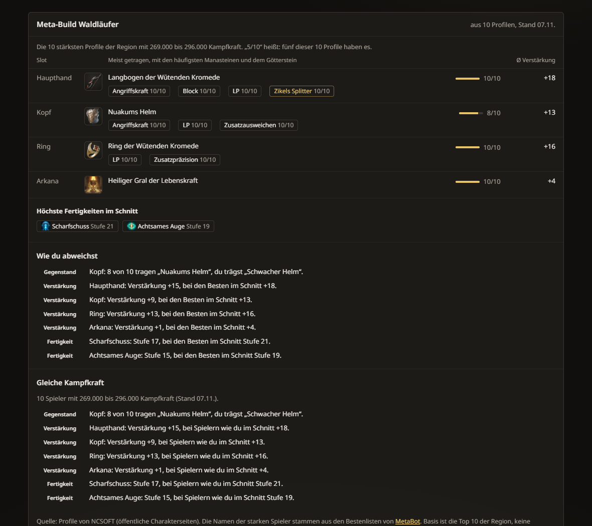
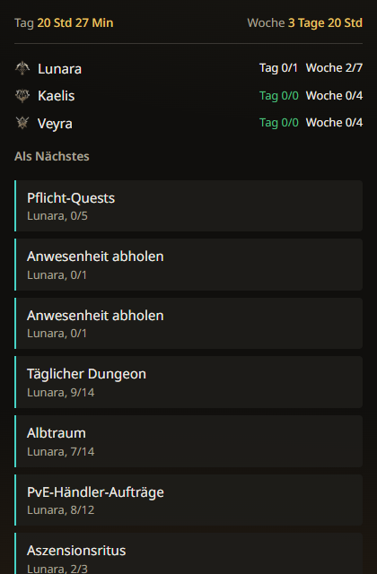

# Odyl

**Aufgaben-Tracker, Charakter-Vergleich und Meta-Build für AION 2 Global.** Ein kleines Windows-Programm für dich und deine Freunde, ohne Konto und ohne Werbung.

*English in short: Odyl is an unofficial Windows companion for AION 2 Global (German interface). It tracks your daily and weekly tasks for your main and twinks, compares characters, and shows what the strongest players of a class wear. It is free, runs locally, and is not affiliated with NCSOFT.*

[**⬇ Aktuelle Version herunterladen**](../../releases/latest) · [Fragen und Fehler melden](../../issues)

*Bildschirmfotos mit Beispieldaten (fiktive Charaktere).*

## Was Odyl kann

**Aufgaben**
- Tägliche und wöchentliche Aufgaben für deinen Main und deine Twinks, mit den echten Reset-Zeiten. Erledigtes rutscht nach unten, serverweite Aufgaben erscheinen nur beim Main.
- Ein Planer, der zeigt, was bis zum Tages- und Wochenreset noch offen ist.
- Timer für Events (Dimensionsinvasion, Riss, Artefakt-Eroberung und andere) mit Erinnerung auf dem Desktop.
- Neue Events und Patchnotizen übernimmt Odyl automatisch, ebenso die Twitch-Drops.

**Charakter**
- Dein Profil aus der öffentlichen NCSOFT-Charakterseite: Ausrüstung mit Manasteinen und Götterstein, Werte, Titel, Daevanion, Fertigkeiten und der Verlauf deiner Kampfkraft.
- Vergleich mit Freunden und starken Spielern, mit sichtbaren Unterschieden bei Ausrüstung und Daevanion.

**Bestenliste und Meta-Build**
- Die stärksten bekannten Spieler pro Klasse und was sie gemeinsam haben: meistgetragene Gegenstände, häufigste Manasteine, Götterstein, höchste Fertigkeiten.
- Wo dein Build abweicht, in Klartext, und ein Vergleich mit Spielern deiner Klasse bei ähnlicher Kampfkraft. Jede Aussage nennt die Zahl der Profile und das Datum. Bei weniger als fünf Profilen sagt Odyl nichts, statt zu raten.

*Beispieldaten. Die Namen der starken Spieler stammen aus den Bestenlisten von [MetaBot](https://metabot.gg/en/aion-2/leaderboards), die Profile holt Odyl bei NCSOFT.*

**Alltag**
- Kompaktes Fenster, das neben dem Spiel liegen kann.
- Läuft im Tray, startet auf Wunsch mit Windows, installiert Updates von selbst, sobald das Fenster nicht im Weg ist.
- Freunde-Gruppen: Fortschritt miteinander teilen.
- Datensicherung deiner Einstellungen und deines Fortschritts.

## Installieren

1. Lade `Odyl-Setup-<Version>.exe` von der [Releases-Seite](../../releases/latest) herunter und starte sie. Windows 10 oder 11, 64 Bit. Es braucht keine Administratorrechte.
2. **Windows warnt beim ersten Start.** Die Datei ist nicht digital signiert (das kostet Geld und lohnt sich für ein Freundesprojekt nicht). Klicke auf „Weitere Informationen“ und dann auf „Trotzdem ausführen“.
3. Beim ersten Start suchst du deinen Hauptcharakter (Name wie im Spiel), Odyl findet ihn bei NCSOFT. Twinks fügst du danach in den Einstellungen hinzu.

Updates kommen automatisch. Odyl fragt alle zehn Minuten nach und installiert, sobald das Fenster versteckt oder nicht im Vordergrund ist, zum Beispiel wenn das Spiel vorne läuft.

## Spieldaten mitlesen (optional, standardmäßig aus)

Odyl kann Aufgaben von selbst abhaken. Dafür liest es den **Netzwerkverkehr des Spiels auf deinem eigenen PC passiv mit**, so wie es verbreitete DPS-Meter tun. Es verändert nichts, sendet nichts an das Spiel und greift nicht in den Spielclient ein.

- Gelesen werden Eintritte, Belohnungen, Odenergie, Schlüssel und die Anwesenheit bei Events.
- Es braucht [Npcap](https://npcap.com). Odyl lädt den offiziellen Installer auf Knopfdruck von npcap.com und startet ihn (Npcap selbst wird nicht mitgeliefert); du kannst ihn auch selbst installieren.
- **Das Risiko für deinen Account bleibt.** NCSOFT hat dieses Mitlesen nicht genehmigt. Die Regeln verbieten „nicht autorisierte Programme“, passives Mitlesen wird dort nicht ausdrücklich genannt. Viele Spieler nutzen solche Werkzeuge, aber es ist deine Entscheidung. Odyl erklärt das beim Einschalten noch einmal und lässt sich jederzeit wieder ausschalten.
- Alles andere in Odyl funktioniert ohne das Mitlesen vollständig.
- Mitgelesene Daten bleiben auf deinem PC. Daten anderer Spieler werden nicht ausgewertet und nicht hochgeladen.

## Datenschutz

- Dein Fortschritt, deine Charaktere und deine Einstellungen liegen **lokal auf deinem PC**.
- Odyl ruft öffentliche Charakterseiten und Patchnotizen von NCSOFT ab, gedrosselt und mit Zwischenspeicher.
- Für Bestenliste, Gruppen und Spieldaten nutzt Odyl einen kleinen Server ([Supabase](https://supabase.com)). Lädst du ein Profil, meldet Odyl dessen Kennung dorthin, der Server holt die **öffentlichen** Profildaten selbst bei NCSOFT und legt sie im gemeinsamen Pool ab. Eine Freunde-Gruppe teilt deinen Aufgabenfortschritt mit den Mitgliedern.
- Es gibt kein Tracking und keine Werbung.

## Hinweise

- Odyl ist ein **inoffizielles Fan-Werkzeug** und steht in keiner Verbindung zu NCSOFT. AION ist eine Marke von NCSOFT.
- Die Nutzung geschieht auf eigene Verantwortung, es gibt keine Gewähr. Wenn NCSOFT ihre Schnittstellen ändert, können Teile vorübergehend ausfallen.
- Die Spieldaten kommen von den öffentlichen NCSOFT-Seiten. Namen starker Spieler stammen aus den Bestenlisten von MetaBot (mit Quellenlink in Odyl).
- Der Quellcode liegt nicht in diesem Repository, hier liegen nur die Installer.

## Danksagung

- [Aion DPS](https://github.com/SkeeveAN/Aion-DPS-Meter) (MIT-Lizenz) war die Grundlage für das Mitlesen, das Odyl für seine Zwecke eigenständig weitergeführt hat.
- [Npcap](https://npcap.com) für den Zugriff auf den Netzwerkverkehr.
- [MetaBot](https://metabot.gg) für die öffentlichen Bestenlisten.
- Die Schrift ist Noto Sans (SIL Open Font License).

## Fehler und Wünsche

Etwas funktioniert nicht oder dir fehlt etwas? Öffne ein [Issue](../../issues). Hilfreich sind die Version (steht bei „Neuigkeiten“, dem Symbol oben rechts) und, falls vorhanden, ein Bildschirmfoto.
